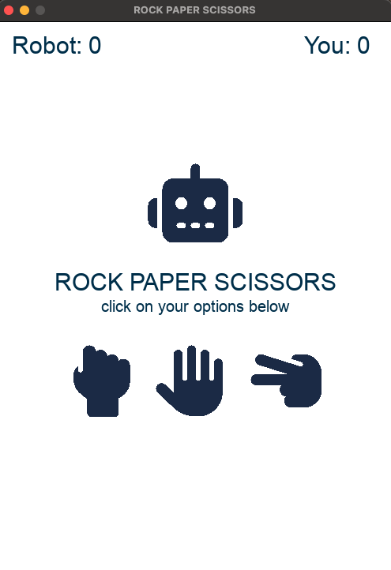

# Rock, Paper, Scissors!

Think you can beat our robot friend? Challenge the computer in a friendly game of Rock, Paper, Scissors!

## About
A fun little side project to practice my Python skills and get familiar with it's frameworks like Pygame.

## How to Play
1. Click one of the three icons: rock, paper, and scissors (in that order).
2. The screen updates to show who won, or whether it's a tie.
3. Your score and the robot's score are tracked in the top corners of the screen.

## Getting Started
1. Make sure you have Python 3 installed.
2. Install Pygame:
   `pip install pygame`
4. Clone this repo and run the game:
   `main.py`

## Tools
- Python
- Pygame

## Future Improvememt
- Add a "Play Again" button with clear instructions
